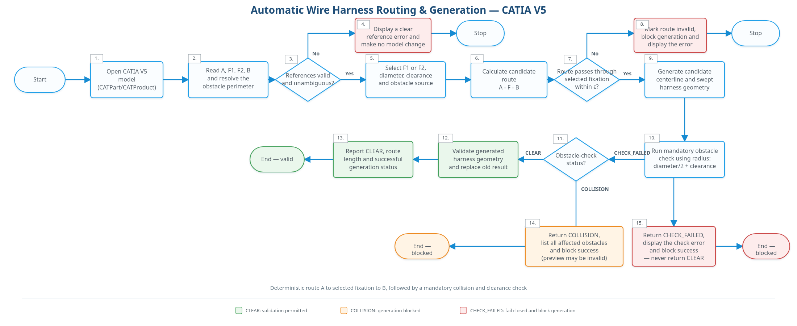

# Project-Enovation

Automatic Wire Harness Routing & Generation Tool (CATIA V5).

## Documents
- `Cahier_des_Charges_Faisceau_Routing.docx` — full specification document (Cahier des Charges).
- `build_cahier.py` — script that generates the Word document.

## Process Flowchart

